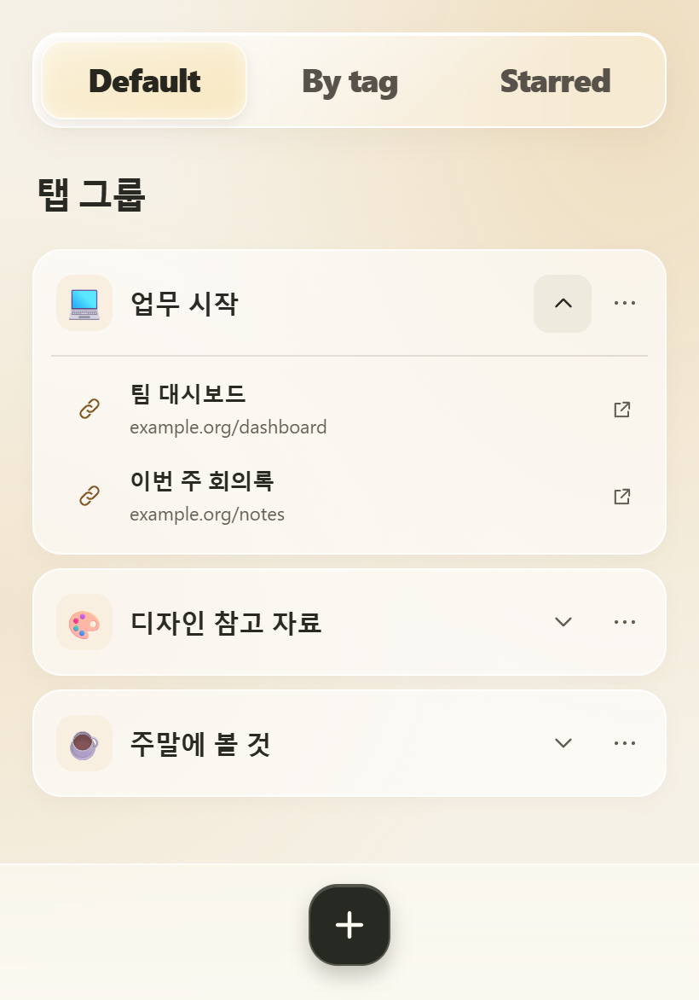
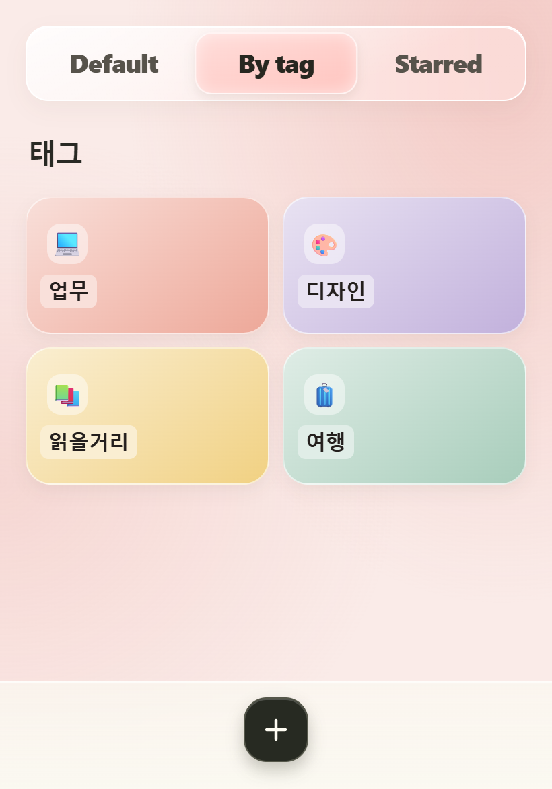
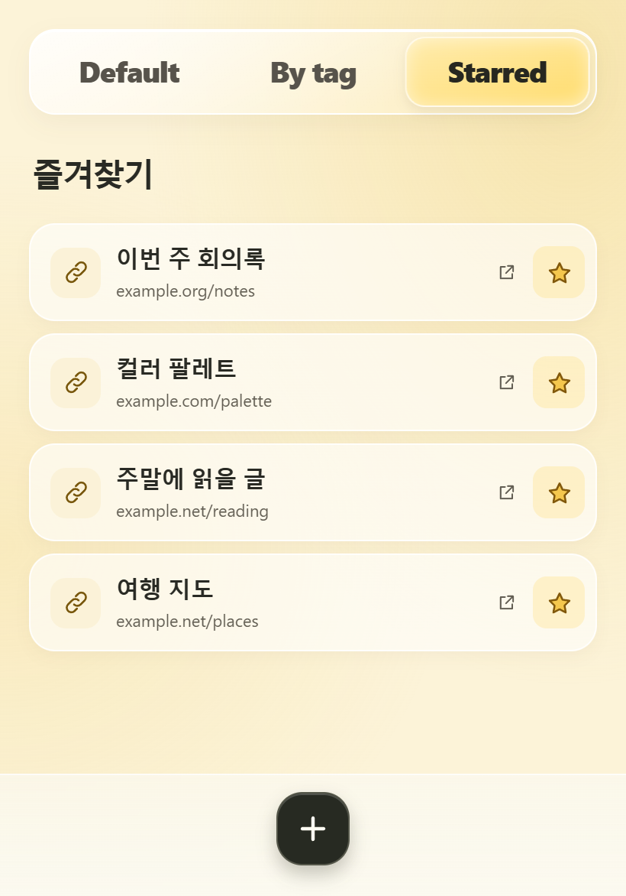

<div align="center">
  
  <h1>탭 모아 · Tabmoa</h1>
  <p><strong>흩어진 탭을 모아 두고, 필요할 때 한 번에.</strong></p>
  <p>Chrome 확장 프로그램 · Manifest V3 · v1.1.0</p>
  <p><a href="#설치">설치</a> · <a href="#사용법">사용법</a> · <a href="#프로젝트-구조">프로젝트 구조</a></p>
</div>

업무에 필요한 도구, 여행 준비 링크, 나중에 읽을 글. 함께 쓰는 페이지는 탭 그룹으로 묶고, 자주 찾는 페이지는 별표로 저장하세요. 그룹 이름을 누르면 링크가 저장한 순서대로 Chrome 탭 그룹에 열립니다.

## 미리보기

| Default · 탭 그룹 | By tag · 태그 | Starred · 즐겨찾기 |
| :---: | :---: | :---: |
|  |  |  |

상단의 반투명 선택창에서 메뉴를 바꾸면 선택 표시가 젤리처럼 움직이고 팝업 색이 바뀝니다. 태그를 열면 해당 태그의 색이 적용됩니다.

## 설치

Chrome 111 이상에서 사용할 수 있습니다.

1. 이 저장소의 **Code → Download ZIP**을 누르고 압축을 풉니다.
2. Chrome 주소창에 `chrome://extensions`를 입력하고 **개발자 모드**를 켭니다.
3. **압축해제된 확장 프로그램을 로드합니다**를 누르고 `manifest.json`이 들어 있는 폴더를 선택합니다.
4. Chrome 도구 모음의 퍼즐 아이콘에서 **탭 모아**를 고정합니다.

기존 설치를 업데이트하려면 새 파일을 **이미 불러온 폴더**에 덮어쓴 뒤 `chrome://extensions`의 **탭 모아** 카드에서 새로고침을 누르세요. 같은 폴더를 사용하면 저장한 그룹과 즐겨찾기를 계속 쓸 수 있습니다.

## 사용법

### 그룹으로 묶고, 태그로 찾기

1. **+ → 탭 그룹**에서 이름을 입력하고 웹페이지 주소를 추가합니다. **현재 페이지 추가**로 보고 있던 페이지를 바로 넣을 수도 있습니다.
2. 링크마다 별칭을 붙이고 위·아래 버튼으로 순서를 바꿉니다. 별 버튼을 누르면 해당 링크가 즐겨찾기에도 저장됩니다.
3. 기존 태그를 고르거나 **새 태그**에서 이름과 색을 정합니다. **그룹 저장**을 누르면 목록에 나타납니다.

**Default**에서 그룹 이름이나 아이콘을 누르면 그룹 전체가 열립니다. 펼치기 버튼을 누르면 그룹 안의 링크를 하나씩 열 수 있고, 점 세 개 메뉴에서 그룹을 수정하거나 삭제할 수 있습니다. **By tag**에서는 태그를 골라 해당 그룹만 볼 수 있습니다.

### 페이지 하나만 저장하기

**+ → 즐겨찾기**에서 주소와 원하는 별칭을 입력하세요. **Starred** 목록에는 별칭이 우선 표시됩니다. 그룹을 삭제해도 별표를 달아 둔 페이지는 즐겨찾기에 남습니다.

### 링크를 복사하러 잠깐 나가기

다른 탭으로 이동해 툴바 팝업이 닫혀도 작성 중인 내용은 임시 저장됩니다. **탭 모아** 아이콘을 다시 누르면 이어서 편집할 수 있습니다. 여러 탭을 오가며 링크를 모을 때는 **별도 창에서 편집**을 누르세요. 편집 창은 탭을 바꾸는 동안에도 열려 있습니다.

### PNG 아이콘 붙이기

그룹이나 새 태그를 편집할 때 **PNG 첨부 ↗**를 눌러 별도 창을 열고 파일을 선택하세요. 최대 5MB, 가로·세로 각각 4,096픽셀 이하의 PNG를 지원합니다. 비율을 유지한 채 64×64 아이콘으로 저장합니다.

## 저장 데이터와 권한

그룹, 태그, 즐겨찾기, 편집 초안은 설치한 Chrome 프로필에 저장됩니다. 페이지 주소는 HTTP와 HTTPS를 지원합니다.

| 권한 | 용도 |
| --- | --- |
| `storage` | 그룹, 태그, 즐겨찾기를 `chrome.storage.local`에 저장 |
| `tabGroups` | 열린 탭에 Chrome 탭 그룹 이름과 색을 적용 |
| `activeTab`, `scripting` | **현재 페이지 추가**를 누를 때 활성 탭의 주소와 제목 가져오기 |

## 프로젝트 구조

```text
tabmoa/
├── manifest.json      확장 프로그램 설정과 권한
├── popup.html         툴바 팝업과 별도 편집 창의 공통 구조
├── popup.css          글라스 효과, 메뉴 전환과 색상 테마
├── popup.js           그룹·태그·즐겨찾기 관리, 초안 저장과 탭 열기
├── popup-icons.js     PNG 검증과 크기 조정
├── content.js         현재 웹페이지의 주소와 제목 읽기
├── icons/             Chrome 툴바 및 확장 프로그램 아이콘
└── docs/images/       README 화면 예시
```

HTML, CSS, JavaScript로 구성되어 있어 저장소 폴더를 Chrome에서 바로 불러올 수 있습니다.

## 라이선스

[GNU Affero General Public License v3.0](LICENSE)
